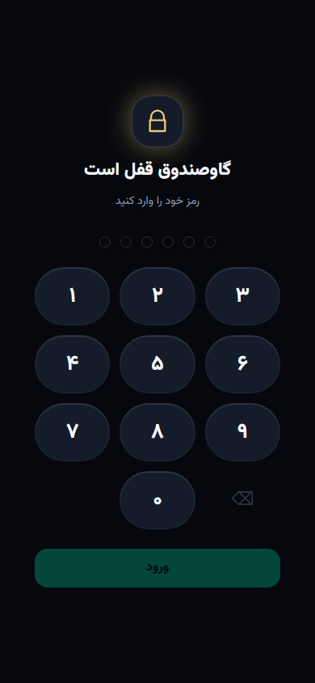
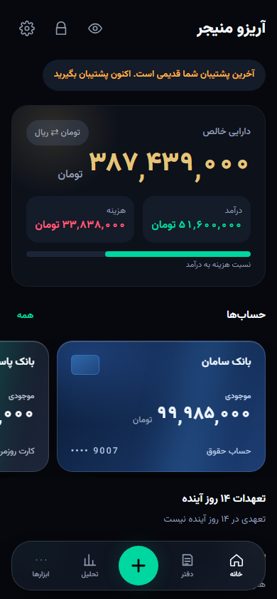
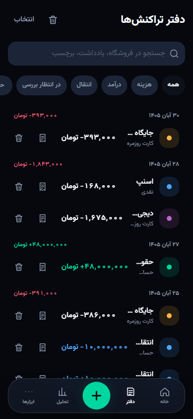
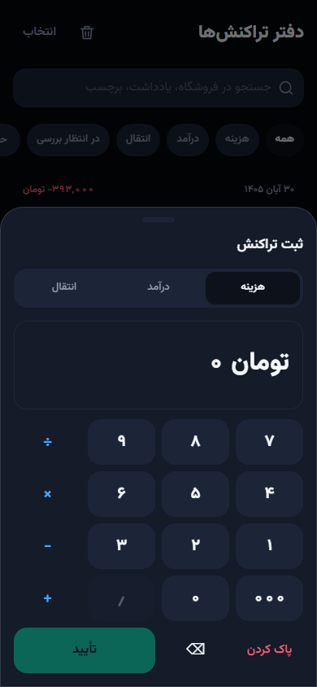
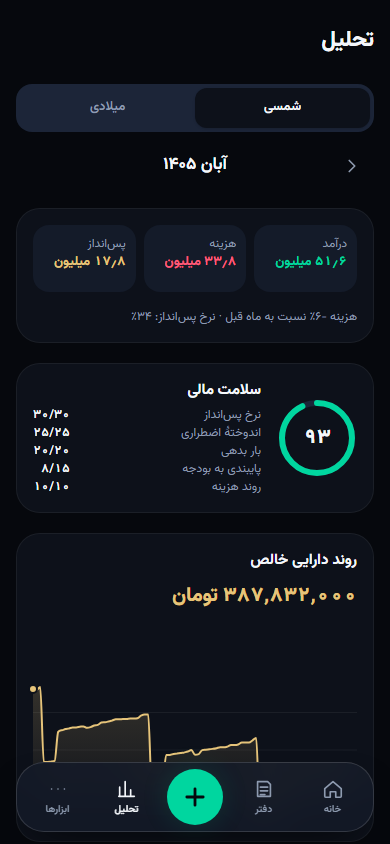
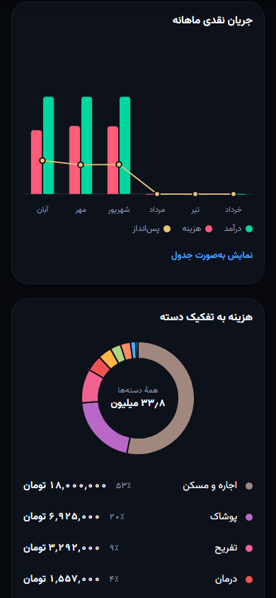
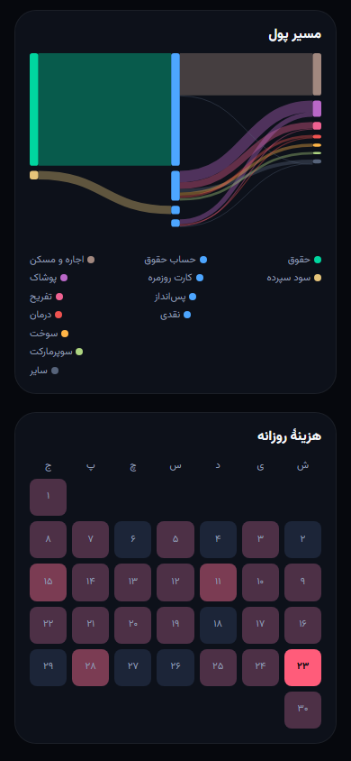
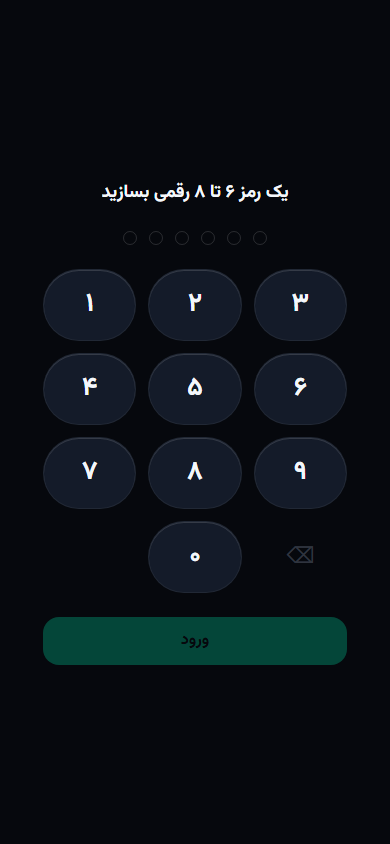
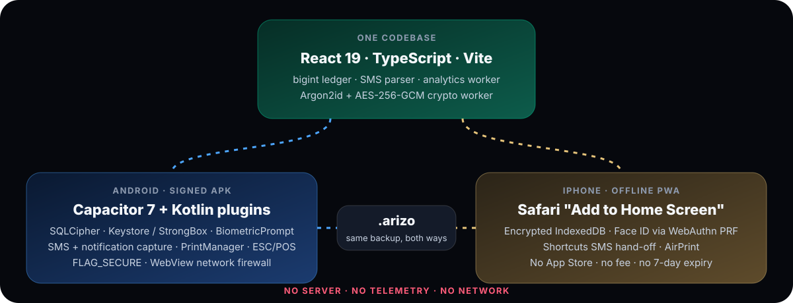

<div align="center">



[English](README.md) · **فارسی**


<br/>


</div>

<div dir="rtl">

## آریزو منیجر چیست؟

آریزو منیجر یک گاوصندوق مالی شخصی است که هیچ‌وقت با هیچ سروری حرف نمی‌زند. همهٔ حساب‌ها، تراکنش‌ها، چک‌ها، وام‌ها و فاکتورها روی خود گوشی شما رمزنگاری می‌شوند. نه ثبت‌نامی دارد، نه فضای ابری، نه آمارگیر. از اول برای فارسی ساخته شده (تقویم شمسی، ریال و تومان، راست‌به‌چپ) و کامل به انگلیسی هم کار می‌کند.

یک کد، دو خروجی: **فایل APK امضاشده برای اندروید** و **وب‌اپ آفلاین آیفون** که از Safari به صفحهٔ اصلی اضافه می‌شود.

</div>


<div dir="rtl">

## نمای برنامه

</div>

<div align="center">

| صفحهٔ قفل | داشبورد | دفتر تراکنش | ثبت تراکنش |
| :---: | :---: | :---: | :---: |
|  |  |  |  |

| تحلیل مالی | نمودارها | جریان پول | ساخت رمز |
| :---: | :---: | :---: | :---: |
|  |  |  |  |

</div>

<div dir="rtl">

## ساختار

</div>



<div dir="rtl">

<details>
<summary><b>امنیت در یک نگاه</b></summary>

| لایه | محافظ |
| --- | --- |
| کلیدها | رمز ← Argon2id (۶۴ مگابایت، ۳ دور) ← کلیدی که کلید تصادفی داده‌ها را باز می‌کند. در اندروید کلید داده فقط در حافظهٔ بومی می‌ماند. |
| رکوردها | هر ردیف جدا با AES-256-GCM، گره‌خورده به جدول و شناسه‌اش (جابه‌جا کردن ردیف‌ها شکست می‌خورد). اندروید همه‌چیز را در SQLCipher نگه می‌دارد. |
| دستگاه | `FLAG_SECURE`، اثر انگشت با Keystore/StrongBox، پردهٔ حریم خصوصی، قفل خودکار، تأخیر پس از رمز اشتباه، پاک‌سازی اختیاری، رمز اضطراری (وب و آیفون). |
| شبکه | CSP سخت‌گیر بدون هیچ آدرس بیرونی، دیوار آتش WebView که به هر درخواست بیرونی ۴۰۳ می‌دهد، بدون Firebase و آمارگیر. |
| پیامک | پیامک رمز یک‌بارمصرف و تبلیغاتی پیش از هر ذخیره‌ای دور ریخته می‌شود. متن پیامک هرگز به لاگ، اعلان یا آدرس نمی‌رسد. |
| پشتیبان | فایل `.arizo`: کلید تصادفی فایل که با عبارت عبور شما (Argon2id) و کلید بازیابی ۲۴ کلمه‌ای اختیاری قفل می‌شود. تغییر حتی یک بیت پیش از نوشتن هر چیزی رد می‌شود. |

مدل تهدید کامل: [docs/security.md](docs/security.md)
</details>

<details>
<summary><b>فهرست امکانات</b></summary>

- **حساب‌ها و دفتر**: کارت بانکی با بررسی لوهن و شبا، انتقال با کارمزد، تراکنش چندبخشی، برچسب، تراکنش تکراری، سطل بازیافت با برگشت، تطبیق موجودی. همهٔ مبالغ عدد صحیح‌اند، هیچ‌جا اعشار شناور نیست.
- **موتور پیامک بانکی** (اندروید): پیامک‌ها و اعلان‌های بانک‌هایی که خودتان انتخاب می‌کنید را می‌خواند، ۳۹ قالب بانکی را می‌شناسد، با لمس عددها قالب تازه یاد می‌گیرد و اختلاف موجودی را نشان می‌دهد. هیچ چیز بدون تأیید شما ثبت نمی‌شود. در آیفون با چسباندن متن یا Shortcuts.
- **چک، وام، بدهی**: وضعیت چک صیادی، جدول اقساط دقیق، طلب و بدهی اشخاص، یادآوری محلی ساعت ۹ صبح.
- **تحلیل مالی**: جریان نقدی، ریز دسته‌ها، نمودار سنکی جریان پول، نقشهٔ حرارتی خرج، ارزش خالص در طول زمان، بودجه با سرعت مصرف، هدف پس‌انداز، امتیاز سلامت مالی، شناسایی اشتراک‌ها و بینش‌های ساده. همه آفلاین در یک worker.
- **فاکتور و چاپ**: فاکتور رسمی فارسی با مالیات بر ارزش افزوده، مبلغ به حروف و QR، کاغذ A4/A5 و چاپگر حرارتی ۵۸/۸۰ میلی‌متری (بلوتوث یا شبکهٔ محلی)، صورتحساب، خروجی Excel و CSV، ورود CSV.
- **پشتیبان**: فایل رمزنگاری‌شدهٔ `.arizo` که بین اندروید و آیفون جابه‌جا می‌شود، بررسی پیش از بازیابی، جایگزینی یا ادغام هوشمند، نسخه‌های خودکار محلی.

</details>

## نصب

| سکو | روش |
| --- | --- |
| اندروید | APK را بسازید و امضا کنید، بعد نصب کنید (اندروید ۱۳ به بالا برای پیامک «اجازهٔ تنظیمات محدود» می‌خواهد). |
| آیفون | پوشهٔ `dist/` را روی یک میزبان ایستا بگذارید، در Safari باز کنید، Share ← Add to Home Screen. بدون App Store و بدون انقضای ۷ روزه. |

راهنمای قدم‌به‌قدم: [docs/distribution_fa.md](docs/distribution_fa.md)

## توسعه

</div>

```bash
npm install
npm run dev        # Vite dev server
npm test           # 477 unit tests
npm run e2e        # 32 Playwright tests
npm run build      # production build into dist/
npx cap sync android && cd android && ./gradlew assembleRelease
```

<div dir="rtl">

ابزارها: Node 24، JDK 21، Android SDK. جزئیات بیشتر در [docs/architecture.md](docs/architecture.md) و [docs/sms_engine.md](docs/sms_engine.md).

## وضعیت

همهٔ فازهای برنامه‌ریزی‌شده ساخته شده‌اند و تست‌هایشان سبز است. بخش‌های بومی (دریافت پیامک، SQLCipher، اثر انگشت، چاپ) در نسخهٔ debug و release با R8 کامپایل می‌شوند ولی **هنوز روی گوشی، چاپگر یا آیفون واقعی اجرا نشده‌اند**. تا آن زمان این را نسخهٔ پیش‌نمایش بدانید.

## مجوز و حق نشر

**حق نشر © ۲۰۲۶ امیرحسین تیغی (آریزو). همهٔ حقوق محفوظ است.**

این نرم‌افزار **اختصاصی با کد قابل مشاهده** است، نه متن‌باز. می‌توانید کد را بخوانید و یک نسخه را برای استفادهٔ شخصی و غیرتجاری روی دستگاه خودتان اجرا کنید. کپی، تغییر، توزیع دوباره، انتشار نسخهٔ ساخته‌شده، استفادهٔ تجاری، تغییر نام و نشان، و استفاده از کد برای آموزش هوش مصنوعی بدون اجازهٔ کتبی ممنوع است. «آریزو» و «آریزو منیجر» نشان تجاری‌اند. نقض مجوز بر پایهٔ قانون حمایت از حقوق پدیدآورندگان نرم‌افزارهای رایانه‌ای (۱۳۷۹) قابل پیگرد است.

[متن فارسی مجوز](LICENSE.fa.md) · [LICENSE](LICENSE) (متن ملاک) · [NOTICE](NOTICE) · [مجوز اجزای شخص ثالث](THIRD_PARTY_NOTICES.md) · [سیاست امنیتی](SECURITY.md)

</div>

<div align="center">
<sub>ساختهٔ <b>آریزو</b> · © ۲۰۲۶ امیرحسین تیغی · همهٔ حقوق محفوظ است</sub>
</div>
