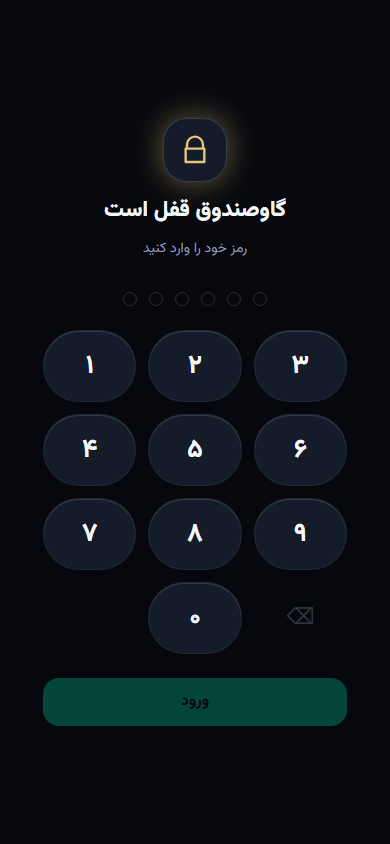
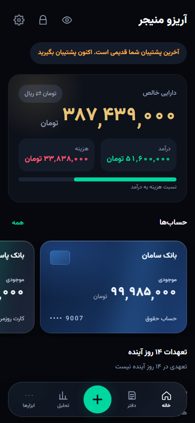
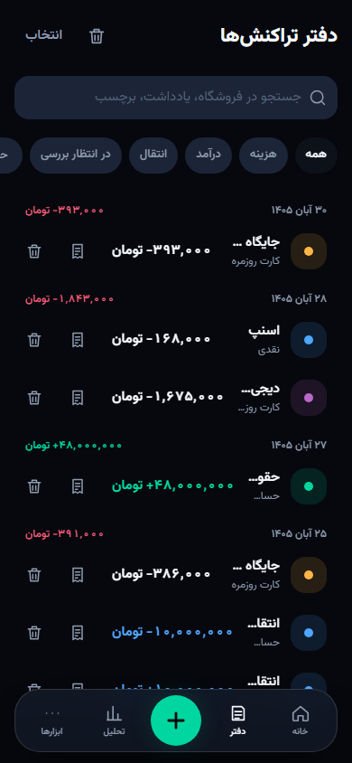
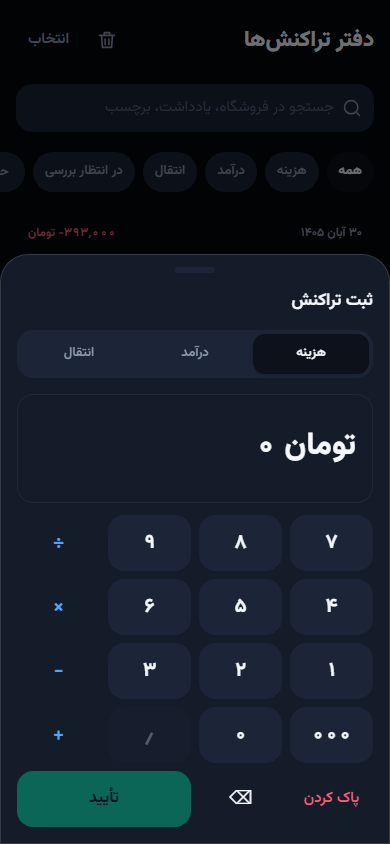
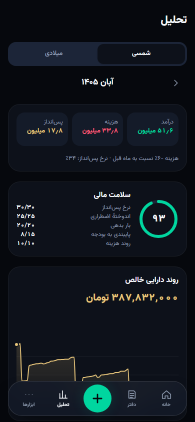
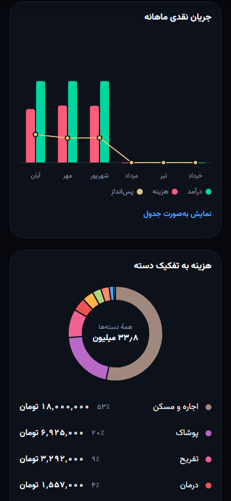
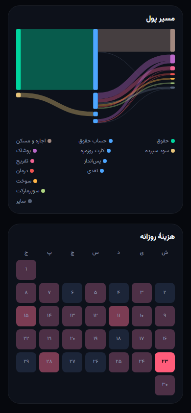
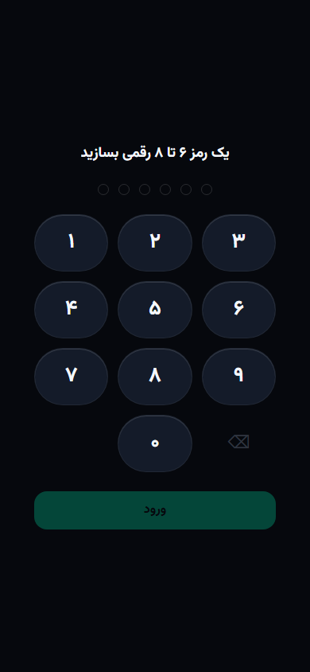
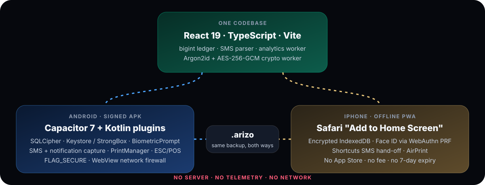

<div align="center">



**English** · [فارسی](README.fa.md)


<br/>


</div>

## What it is

Arizo Manage is a personal finance vault that never talks to a server. Every account, transaction, cheque, loan and invoice is encrypted on your phone. There is no sign-up, no cloud and no analytics. The app is built Persian-first (Jalali calendar, Rial and Toman, right-to-left) and also runs fully in English.

One codebase ships two ways: a signed **Android APK** and an **offline iPhone PWA** you add from Safari.


## Screens

<div align="center">

| Lock | Dashboard | Ledger | New entry |
| :---: | :---: | :---: | :---: |
|  |  |  |  |

| Analytics | Charts | Money flow | PIN setup |
| :---: | :---: | :---: | :---: |
|  |  |  |  |

</div>

## How it is built



<details>
<summary><b>Security in one screen</b></summary>

| Layer | What protects it |
| --- | --- |
| Keys | PIN → Argon2id (64 MiB, t=3) → key-encryption key that unwraps a random data key. Android keeps the data key in native memory only. |
| Records | AES-256-GCM per row, bound to its store and id (rows can't be swapped). Android stores everything in SQLCipher. |
| Device | `FLAG_SECURE`, Keystore/StrongBox biometrics, privacy curtain, auto-lock, lockout timers, optional wipe, duress PIN (web/iOS). |
| Network | Strict CSP with no remote origin, a WebView firewall that answers every outside request with 403, no Firebase or telemetry. |
| SMS | OTP and promo messages are dropped before anything is stored. SMS text never reaches a log, a notification or a URL. |
| Backups | `.arizo` file: random file key, wrapped by your passphrase (Argon2id) and an optional 24-word recovery key. Any bit flip fails before restore writes anything. |

Full threat model: [docs/security.md](docs/security.md).
</details>

<details>
<summary><b>Feature list</b></summary>

- **Accounts and ledger**: bank cards with Luhn and Sheba checks, transfers with fees, split transactions, tags, recurring rules, trash with undo, balance reconcile. All money is integer minor units, never floating point.
- **Bank SMS engine** (Android): reads bank SMS and notifications from apps you choose, parses 39 bank templates, learns new formats by tapping numbers, flags balance drift. Nothing posts without your review. iPhone users paste or use a Shortcut.
- **Cheques, loans, debts**: Sayad cheque status machine, exact installment schedules, people you owe or who owe you, local reminders at 09:00.
- **Analytics**: cashflow, category drill-down, Sankey money flow, spending heatmap, net worth over time, budgets with burn rate, savings goals, a financial health score, subscription detection and plain-language insights. All computed offline in a worker.
- **Invoices and printing**: official Persian invoices with VAT, total in words and QR, A4/A5 and 58/80 mm thermal printers (Bluetooth or LAN), statements, Excel and CSV export, CSV import.
- **Backup**: encrypted `.arizo` files that move between Android and iPhone, dry-run inspection, replace or smart merge, rolling local snapshots.

</details>

## Install

| Platform | How |
| --- | --- |
| Android | Build and sign the APK, then install it (Android 13+ needs "Allow restricted settings" for SMS). |
| iPhone | Host the `dist/` folder on any static host, open it in Safari, Share → Add to Home Screen. No App Store, no 7-day expiry. |

Step-by-step guide (Persian): [docs/distribution_fa.md](docs/distribution_fa.md).

## Develop

```bash
npm install
npm run dev        # Vite dev server
npm test           # 477 unit tests
npm run e2e        # 32 Playwright tests
npm run build      # production build into dist/
npx cap sync android && cd android && ./gradlew assembleRelease
```

Toolchain: Node 24, JDK 21, Android SDK. More in [docs/architecture.md](docs/architecture.md) and [docs/sms_engine.md](docs/sms_engine.md).

## Status

All planned phases are built and pass their tests. The native parts (SMS capture, SQLCipher, biometrics, printing) compile in debug and R8 release builds but **have not yet been run on a real phone, printer or iPhone**. Treat it as a preview until that is done.

<div align="center">
<sub>Made by <b>Arizo</b> · no license chosen yet, all rights reserved</sub>
</div>
